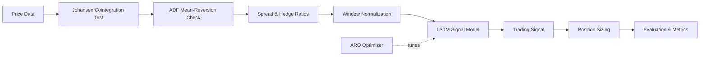

<div align="center">

# 📈 ARO-LSTM Pairs Trading

### Statistical arbitrage with cointegration, LSTM signal forecasting, and ARO-based optimization


[Overview](#-overview) •
[How It Works](#-how-it-works) •
[Project Structure](#-project-structure) •
[Getting Started](#-getting-started) •
[Results](#-results) •
[Roadmap](#-roadmap)

</div>

---

## 📖 Overview

**Pairs trading** is a market-neutral statistical arbitrage strategy. If two assets are **cointegrated**, their spread tends to revert to a long-run mean. When the spread drifts away from that mean, we go long the underpriced asset and short the overpriced one, then close both positions when the spread reverts.

This project builds a complete pairs-trading pipeline that:

1. **Tests** whether a pair is cointegrated (Johansen) and mean-reverting (ADF).
2. **Forecasts** the next-day trading signal with an **LSTM** neural network.
3. **Optimizes** the model with **ARO** <!-- TODO: confirm what ARO stands for (e.g. Artificial Rabbits Optimization) and what it tunes (hyperparameters / thresholds / hedge ratios) -->.
4. **Sizes positions** from hedge ratios, which determine capital allocation between the two legs.
5. **Evaluates** performance using portfolio metrics and RMSPE.

> ⚠️ **Disclaimer:** This project is for research and educational purposes only. It is not financial advice, and past backtest performance does not guarantee future results.

---

## ✨ Key Features

| Feature | Description |
|---|---|
| 🔗 **Cointegration testing** | Johansen test, run in a loop across candidate pairs |
| 🔄 **Mean-reversion check** | Augmented Dickey-Fuller (ADF) test on the spread |
| 🧠 **LSTM forecasting** | Predicts the next-day trading signal from windowed, normalized data |
| 🐇 **ARO optimization** | Metaheuristic optimization of the model <!-- TODO: specify --> |
| ⚖️ **Hedge-ratio sizing** | Capital allocation derived from cointegration hedge ratios |
| 📊 **Evaluation suite** | Portfolio metrics and RMSPE on train and test sets |

---

## ⚙️ How It Works



### 1. Pair selection
Candidate pairs are screened with the **Johansen cointegration test**. The **ADF test** then confirms the spread is stationary (mean-reverting).

### 2. Signal generation
The spread is normalized using a rolling window and fed to an **LSTM**, which predicts the signal for the next trading day. The signal marks the moments of deviation from, and reversion to, the mean.

### 3. Position sizing
Hedge ratios from the cointegration vector decide how much capital goes into each leg of the pair.

### 4. Evaluation
Strategy performance is measured on both the training and test sets using portfolio metrics and RMSPE.

---

## 📁 Project Structure

```
ARO-LSTM-Pairs-Trading/
├── check_johansen_loop.py   # Johansen cointegration test, run in a loop over pairs
├── check_mean_reversion.py  # ADF test for mean reversion of two time series
├── AUDCAD_unequal_mod.py    # Main entry point
├── model.py                 # Builds/trains the LSTM and predicts the trading signal
├── seq_norm.py              # Window normalization and data prep for the LSTM
├── evaluation.py            # Portfolio metrics and RMSPE
├── requirements.txt         # Python dependencies
└── README.md
```
<!-- TODO: add any ARO-specific files (e.g. aro.py) and the data/ folder if present -->

---

## 🚀 Getting Started

### Prerequisites
- Python 3.8+
- pip

### Installation

```bash
# 1. Clone the repository
git clone https://github.com/navya1009/ARO-LSTM-Pairs-Trading.git
cd ARO-LSTM-Pairs-Trading

# 2. (Optional) Create a virtual environment
python -m venv venv
source venv/bin/activate        # Windows: venv\Scripts\activate

# 3. Install dependencies
pip install -r requirements.txt
```

### Usage

```bash
# Step 1: Check cointegration across candidate pairs
python check_johansen_loop.py

# Step 2: Verify mean reversion of the chosen pair
python check_mean_reversion.py

# Step 3: Run the full pipeline (train LSTM, generate signals, evaluate)
python AUDCAD_unequal_mod.py
```

---

## 🧰 Tech Stack

| Library | Purpose |
|---|---|
| **TensorFlow / Keras** | LSTM model |
| **Statsmodels** | Johansen and ADF tests |
| **NumPy** | Numerical computation |
| **Pandas** | Data handling |
| **Matplotlib** | Visualization |

---

## 📊 Results

<!-- TODO: replace with your actual numbers and screenshots -->

| Metric | Train | Test |
|---|---|---|
| RMSPE | – | – |
| Sharpe Ratio | – | – |
| Annualized Return | – | – |
| Max Drawdown | – | – |

---

## 🗺️ Roadmap

- [ ] Extend to multiple pairs and a portfolio of pairs
- [ ] Add transaction costs and slippage
- [ ] Compare ARO against other optimizers (PSO, GA, Grid Search)
- [ ] Add walk-forward validation
- [ ] Add a notebook walkthrough

---

## 📚 References

- Selection of a Portfolio of Pairs Based on Cointegration: A Statistical Arbitrage Strategy
- Flori, A. et al. (2021). *Revealing Pairs-trading opportunities with long short-term memory networks.*
- Original LSTM pairs-trading project: [shimonanarang/pair-trading](https://github.com/shimonanarang/pair-trading)
<!-- TODO: add the ARO paper reference -->

---

## 🤝 Contributing

Contributions are welcome.

1. Fork the repo
2. Create a feature branch: `git checkout -b feature/your-feature`
3. Commit your changes: `git commit -m "Add your feature"`
4. Push the branch: `git push origin feature/your-feature`
5. Open a Pull Request

---

## 📄 License

Distributed under the MIT License. See `LICENSE` for details.
<!-- TODO: confirm the license, or add a LICENSE file -->

---

<div align="center">

**Built by [Sanchit](https://github.com/sanchit037nit)** · If you found this useful, consider giving it a ⭐

</div>